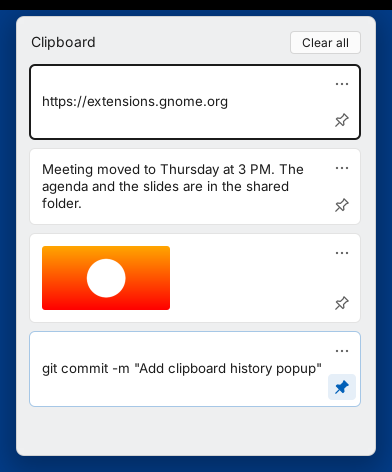

# Clipboard History Popup

A GNOME Shell extension that shows your clipboard history in a floating popup, right next to the text cursor — similar to Win+V on other systems.



## Features

- **Opens next to the text cursor** (falls back to the mouse pointer when the app doesn't report the cursor position).
- **Pastes directly** into the field you were typing in — click an item or press Enter (terminals get Ctrl+Shift+V).
- **Pin items** to keep them after a reboot. Pinned items always stay at the end of the list.
- **Image support** with previews.
- **Delete items** from the "⋯" menu. Deleting a pinned item asks for confirmation.
- **Keyboard operations**: ↑ ↓ to move, Enter to paste, Delete/Backspace to delete, P to pin, Esc to close.
- Light, dark or automatic theme.
- Ignores content that password managers mark as secret.

## Privacy

The extension reads the clipboard to build the history. Everything stays on your computer; nothing is sent anywhere.

- Unpinned items live in `$XDG_RUNTIME_DIR/clipboard-history-popup` and are cleared on logout or reboot.
- Pinned items are saved in `~/.local/share/clipboard-history-popup`.

## Installation

### From extensions.gnome.org

Coming soon.

### From source

```bash
git clone https://github.com/bncgabriel/clipboard-history-popup.git
cd clipboard-history-popup
./install.sh
```

On Wayland, log out and back in, then enable it:

```bash
gnome-extensions enable clipboard-history-popup@bncgabriel.github.io
```

## Setting the shortcut

No shortcut is set by default. Open the preferences and choose one (**Use Super+V** sets the suggested shortcut):

```bash
gnome-extensions prefs clipboard-history-popup@bncgabriel.github.io
```

GNOME uses Super+V for the notification list. When you pick Super+V for this extension, it is removed from the notification list (which stays on Super+M) and given back when the extension is disabled or you choose another shortcut.

## Preferences

| Option | Default |
| --- | --- |
| Shortcut to open the history | not set |
| Keyboard operations inside the popup | on |
| Theme (light, dark, follow the system) | light |
| Save images | on |
| History size (unpinned items) | 25 |

## Compatibility

GNOME Shell 46, 47, 48, 49 and 50.

## Development

- `./pack.sh` builds the ZIP for extensions.gnome.org in `dist/`.
- `./install.sh` builds and installs it for the current user.
- Test changes without logging out in a nested session: `dbus-run-session gnome-shell --devkit --wayland` (GNOME 49+, package `mutter-dev-bin`).
- Logs: `journalctl -f -o cat /usr/bin/gnome-shell`

### Translations

Translations live in `po/`. To update the template:

```bash
xgettext --from-code=UTF-8 -L JavaScript -k_ -o po/clipboard-history-popup.pot clipboard-history-popup@bncgabriel.github.io/*.js
```

Available languages: English, Portuguese (Brazil).

## License

[GPL-2.0-or-later](LICENSE)
